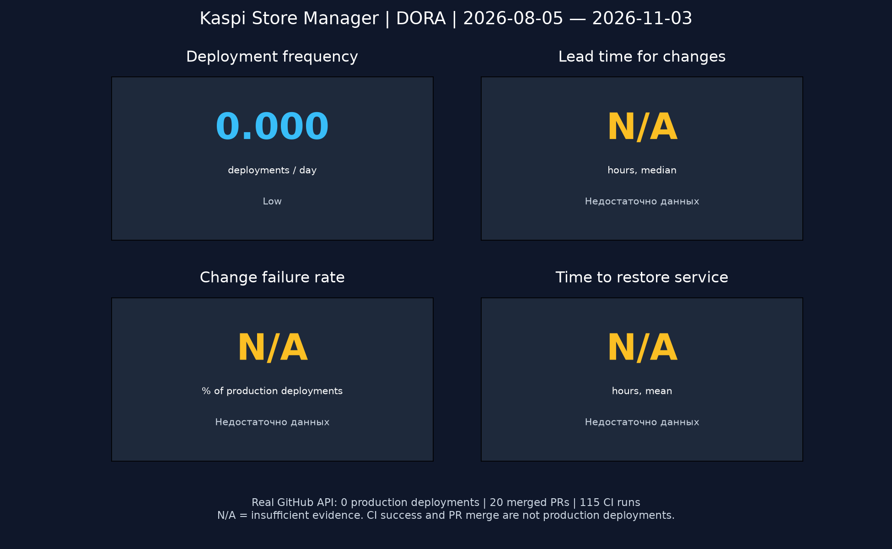

# DORA: базовый отчёт на 03.11.2026

## Источник и окно

GitHub REST API репозитория `Ybuuc/kaspi-store-manager`.
Окно: **[05.08.2026 00:00 UTC; 03.11.2026 00:00 UTC)**, ровно 90 суток.
Время получения и полный список запросов — `data/github.json → requests`.
Все страницы выгружаются до окончания коллекции, включая deployments/statuses, PR,
issues, workflow runs, releases и commits основной ветки.

За окно: **55 коммитов main, 20 merged PR, 115 запусков CI, 112 успешных CI**.
Медиана от открытия PR до merge: **0,0161 часа ≈ 58 секунд**. Это контекст работы
с репозиторием, не lead time до production. Неуспешные/отменённые CI не считаются
production-инцидентами. GitHub Releases отсутствуют.

## Четыре метрики

| Метрика | Формула и результат | Текущий уровень | Ограничение |
|---|---|---|---|
| Deployment Frequency | 0 успешных production-deployments / 90 суток = **0/сутки** | **Low для зарегистрированной истории** | API не доказывает отсутствие развёртываний вне GitHub |
| Lead Time for Changes | медиана(commit committer time → первая успешная доставка изменения в production) = **N/A** | Не определён | Нет production-deployment и baseline SHA |
| Change Failure Rate | distinct deployments, вызвавшие incident / successful production deployments × 100% = **N/A** | Не определён | Знаменатель 0; полнота учёта инцидентов не подтверждена |
| Time to Restore Service / MTTR | среднее(recovery − detection) по восстановленным incidents = **N/A** | Не определён | Нет подтверждённых production-инцидентов и восстановлений |

Отсутствие инцидентов в выгрузке не означает CFR=0% или MTTR=0.
Нельзя честно присвоить команде четыре численных уровня при такой истории.
Это выявленный пробел наблюдаемости, который нужно закрыть для полного выполнения
критерия «четыре метрики на реальных production-данных».

## Методика и классификация

Историческая шкала DORA 2021 используется как учебный ориентир, а не актуальная
универсальная оценка команды. Современная модель DORA изменилась; в этой работе
сохранены четыре метрики из задания.

В скрипте границы упрощены до непрерывных интервалов:

| Метрика | Elite | High | Medium | Low |
|---|---|---|---|---|
| DF, в сутки | >1 | от 1/30 до 1 включительно | от 1/183 до <1/30 | <1/183 |
| LT, часы | <24 | 24–<168 | 168–<4380 | ≥4380 |
| MTTR, часы | <1 | 1–<24 | 24–<168 | ≥168 |
| CFR | ≤15%: Elite / High / Medium неразличимы по одной метрике | тот же диапазон | тот же диапазон | >15%: Low / вне диапазона отчёта |

Это явная операционализация исторических категорий, не дословная таблица отчёта:
например, для LT разрыв между неделей и месяцем отнесён к Medium.
Сравнение SHA берёт commits между соседними успешными production-развёртываниями;
merge-коммиты исключаются, повторные SHA не увеличивают число изменений.
Первое развёртывание без предыдущего baseline исключает надёжную оценку LT окна:
неизвестные образцы не заменяются временем создания PR.
При повторной доставке того же SHA набор новых изменений пуст.

Инциденты связываются с deployment через `data/incidents.json`:
`{"issue_number": 123, "deployment_id": 456}`. Issue должна реально существовать
в выгрузке и иметь label `incident`. Создание issue = обнаружение, закрытие после
проверки = восстановление. Это выбранная измерительная конвенция; задержка
регистрации/закрытия искажает MTTR. Не закрытые к концу окна incidents показываются
отдельно и не получают нулевое время. Для CFR каждый deployment считается один раз.
`complete=true` допустим только после проверки полноты журнала за весь интервал.
Расчёт MTTR по закрытым incidents может быть оптимистичен при наличии незакрытых.

## Два конкретных улучшения

1. **Малые релизы дважды в неделю с единым CI-gate.** Ответственный @Ybuuc;
   срок — ближайшие 2 недели. Каждый релиз получает SHA, проверенный ZIP,
   GitHub deployment `production` и success только после smoke-проверки целевой
   установки. За следующие 30 дней цель — **≥8 реальных доставок (≥0,267/сутки)**;
   после появления baseline целевой LT **≤24 часов**. Ожидается сокращение размера
   изменений и ожидания доставки. Это целевые эффекты, ещё не измеренный результат.
2. **Независимое ревью + проверенный откат и журнал incident.** Разработчик @Ybuuc,
   ревьюер — назначаемый преподаватель/участник с write-доступом; назначить до
   следующего merge. За неделю провести один отдельный учебный rollback drill
   (не считать его production-инцидентом). Для реальных сбоев сразу создавать
   incident, связывать deployment ID и фиксировать подтверждённое восстановление.
   Цель после 10 production-доставок — **CFR ≤15%, MTTR <1 часа**;
   учебный откат — **≤15 минут**, включая проверку SQLite. Проверять цели раз в месяц;
   при нуле реальных incidents MTTR остаётся N/A.

## Первоисточники

- [DORA 2021](https://dora.dev/research/2021/dora-report/) — исторические уровни.
- [История метрик DORA](https://dora.dev/insights/dora-metrics-history/) — эволюция модели.
- [Four Keys: расчёты](https://github.com/dora-team/fourkeys/blob/main/METRICS.md) — связь изменений, доставок и сбоев.
- [GitHub Deployments API](https://docs.github.com/en/rest/deployments/deployments) — источник production-событий.
