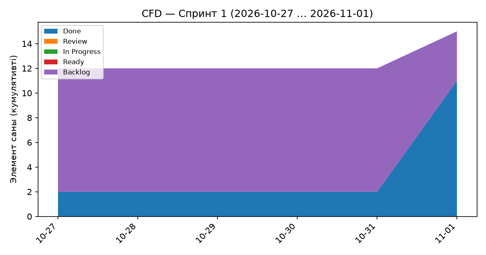
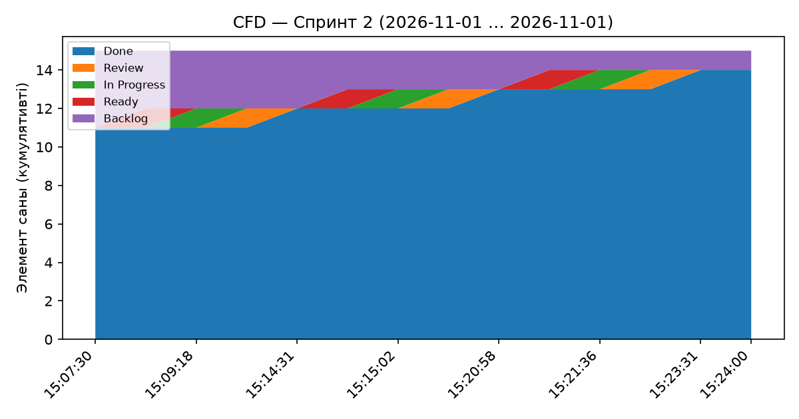

# ЛЗ 9 — Екі спринттің ағын метрикалары

> Бұл файлдағы барлық сандар `scripts/flow_metrics.py` арқылы GitHub Projects тақтасының оқиғалар тарихынан есептелген. Қолмен енгізілген мән жоқ.

## 1. Дерек көзі

- Көз: GitHub REST issue timelines (timestamps and event IDs) combined with visible GitHub Project #1 status transitions; accelerated closeout (тақта: «Kaspi Store Manager Development»)
- Экспорт уақыты: 2026-11-01 10:24:17 UTC
- Шикі экспорт: `data/raw-export.json`, SHA-256: `8eae1907d1cc339872111ef211a67e206402023d1a1334be53409e94a8652f18`
- Метрикаға алынған task-issue: 15; тақтадағы барлық issue: 41
- Parent US, dependency және milestone карточкалары throughput, cycle time, CFD және WIP есебінен шығарылды; олар task-issue емес.
- Спринт 1: 2026-10-27T00:00:00+05:00 … 2026-11-01T15:07:30+05:00 (соңы есепке кірмейді); Спринт 2: 2026-11-01T15:07:30+05:00 … 2026-11-01T15:24:00+05:00 (соңы есепке кірмейді)
- WIP-лимиттер: Ready ≤ 4, In Progress ≤ 2, Review ≤ 2
- Анықтамалар: cycle time = In Progress бағанына алғаш кіруден Done-ға дейінгі күнтізбелік күн; throughput = спринт ішінде Done болған элемент саны; p85 = nearest-rank әдісі.

## 2. Салыстыру кестесі

| Метрика | Спринт 1 | Спринт 2 | Δ (С2 − С1) |
|---|---:|---:|---:|
| Throughput (Done саны) | 9 | 3 | -6 |
| Cycle time, орташа (күн) | 0.2946 | 0.0030 | -0.2916 |
| Cycle time, медиана (күн) | 0.0991 | 0.0036 | -0.0955 |
| Cycle time, p85 (күн) | 0.5972 | 0.0041 | -0.5931 |
| Cycle time үшін элемент саны (n) | 9 | 3 | |
| Орташа WIP снимков CFD: Ready (лимит 4) | 0.00 | 0.21 | +0.21 |
| Орташа WIP снимков CFD: In Progress (лимит 2) | 0.00 | 0.21 | +0.21 |
| Орташа WIP снимков CFD: Review (лимит 2) | 0.00 | 0.21 | +0.21 |
| Ең жоғары бірмезгілдегі WIP: Ready | 1 | 1 | +0 |
| Ең жоғары бірмезгілдегі WIP: In Progress | 9 | 1 | -8 |
| Ең жоғары бірмезгілдегі WIP: Review | 3 | 1 | -2 |
| Баған ішіндегі орташа уақыт: Ready (күн) | 0.2 | 0.0 | -0.2 |
| Баған ішіндегі орташа уақыт: In Progress (күн) | 0.2 | 0.0 | -0.2 |
| Баған ішіндегі орташа уақыт: Review (күн) | 0.1 | 0.0 | -0.1 |
| Тар орынға үміткер (WIP/лимит ең жоғары) | In Progress | In Progress | |

## 3. Спринт 1 — толығырақ

Кезең: 2026-10-27T00:00:00+05:00 … 2026-11-01T15:07:30+05:00 (соңы есепке кірмейді). Аяқталған элементтер:

| Issue | Атауы | Cycle time (күн) |
|---|---|---:|
| #3 | [TASK] MVP талаптарын анықтау | 0.0038 |
| #30 | SEC-01: Қауіпсіздік скандарын CI-ге қосу (Trivy + gitleaks) | 0.0504 |
| #31 | SEC-02: Аутентификация мен RBAC үшін теріс тесттер қосу | 0.0505 |
| #34 | US-01.1 — Login form validation | 0.0991 |
| #35 | US-01.2 — Valid and invalid login | 0.5967 |
| #36 | US-01.3 — Protect authenticated pages | 0.5972 |
| #37 | US-02.1 — Display product list fields | 0.5973 |
| #38 | US-02.2 — Empty state and list performance | 0.0593 |
| #39 | US-02.3 — Open product details from list | 0.5972 |

CFD деректері: `cfd-sprint1.csv`.

Тар орынға үміткер: **In Progress** (peak WIP/лимит = 4.50). Бұл — формулалық үміткер; түпкілікті қорытындыны CFD жолақтарын қарап ретроспективада растаңыз.

## 4. Спринт 2 — толығырақ

Кезең: 2026-11-01T15:07:30+05:00 … 2026-11-01T15:24:00+05:00 (соңы есепке кірмейді). Аяқталған элементтер:

| Issue | Атауы | Cycle time (күн) |
|---|---|---:|
| #55 | S2-02 — Проверить учебный сценарий сквозным проходом | 0.0041 |
| #56 | S2-01 — Проверить запуск ИС из чистой копии | 0.0036 |
| #57 | S2-03 — Проверить инструкцию показа и ссылки | 0.0013 |

CFD деректері: `cfd-sprint2.csv`.

Тар орынға үміткер: **In Progress** (орташа WIP снимков CFD/лимит = 0.11). Бұл — формулалық үміткер; түпкілікті қорытындыны CFD жолақтарын қарап ретроспективада растаңыз.

## 5. Ағында не өзгерді және неге

Екі отрезоктың ұзақтығы жоспардағы екі аптадан қысқартылды: Спринт 1 01.11.2026 15:07:30-да, Спринт 2 сол күні 15:24:00-де аяқталды (Asia/Qyzylorda). Бұл — 01.11.2026-дағы жаңа тапсыру мерзіміне бейімделген оқу есебі. Бастапқы жоспардағы 03–09.11.2026 оқиғалары алдын ала есепке қосылған жоқ.

- Ретроспективадағы **жалғыз әрекет**: Ybuuc екінші отрезокта бір уақытта тек бір QA task-issue-ін In Progress-те ұстады; келесісін алдыңғысы Done болғаннан кейін бастады. Өлшем — оқиға тарихынан алынған peak WIP In Progress. Спринт 1: 9, мақсат: ≤1, Спринт 2: 1. Мақсат орындалды.
- Throughput 9-дан 3-ке өзгерді, өйткені бірінші отрезокта әзірлеу және қауіпсіздік task-тары, екіншісінде тек үш QA task-ы болды. US-02 бойынша бұрын жасалған жұмыс екінші отрезокқа кері күнмен көшірілген жоқ.
- Орташа cycle time 0,2946-дан 0,0030 күнге, p85 0,5972-ден 0,0041 күнге өзгерді. Бұл QA task-тарының қысқа тексерулері мен отрезоктың 16,5 минуттық ұзақтығына байланысты; бір WIP әрекетінің жылдамдыққа себептік әсері дәлелденбейді.
- CFD: бірінші отрезок соңында Done = 11 (оның 9-ы осы отрезокта), екінші соңында Done = 14. Бірінші отрезоктағы күн соңындағы түсірілімдер In Progress толқынын көрсетпеді; сондықтан peak WIP бөлек есептелді. Екінші отрезокта әр Status оқиғасынан кейінгі CFD түсірілімі алынған. Бірінші отрезокта In Progress лимиті 2 бола тұра peak 9 болғаны — нақты процесс ауытқуы. Екінші отрезокта peak 1.
- Parent US, dependency және milestone карточкалары тақтада бар, кейбірі Done-ға өткен; саясатқа сай метрикаларға тек task-issue кірді. 3 элементі бар екінші отрезок үшін орташа және p85 тек осы тексерулерді сипаттайды; келесі толық спринттің болжамы емес.
